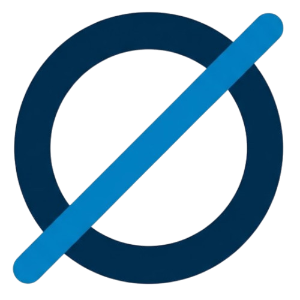
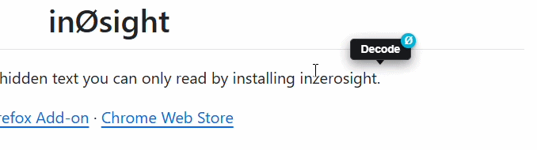
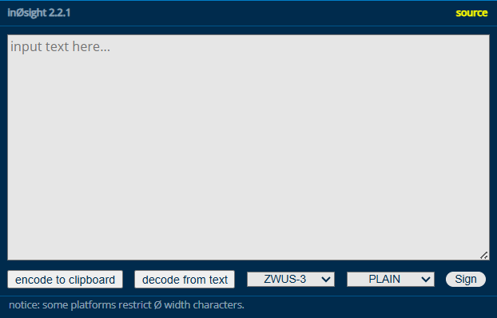

<h1 align="center">inØsight</h1>

<b>Zero-width steganography for your browser.</b> Encode text into invisible Unicode characters and hide it inside ordinary text.

This sentence contains hidden text you can only read by installing inzerosight.‍​­‌‍‏‎‏‌⁠‍⁠‌⁠‍­‌­‎‏‌⁠‏‍‌­​‏‌⁠‏­‌⁠‏‏‌‏‏­‌‎­‌⁠­‏‌⁠‍⁠‌⁠‏⁠‌‎­‌­​⁠‌­​‏‌⁠‍­‌‎­‌⁠‍­‌⁠‍⁠‌⁠‏‎‌‎­‌­​⁠‌⁠‍⁠‌⁠‍‏‌⁠‍‏‌⁠‏⁠‌⁠‍­‌­‎⁠‌­​⁠‌­​‏‌⁠‏­‌­​‎‌‎­‌⁠‏‏‌­​‎‌­​⁠‌⁠‏‍‌­​‎‌⁠‏­‌⁠‍‍‌⁠­‏‌‎­‌­‎⁠‌⁠‍­‌‎­‌⁠‍​‌⁠‍‍‌­​‏‌­‎⁠‌⁠‍­‌‎­‌⁠‏‏‌­‎⁠‌­‎‏‌­‎­‌⁠‏­‌‏‏​

<a href="https://addons.mozilla.org/en-US/firefox/addon/in0sight/">Firefox Add-on</a> · <a href="https://chromewebstore.google.com/detail/acnmohbphjmnbaboacmecidopeplkhog">Chrome Web Store</a>

---

  

  

### Sign
When enabled, prepends an invisible zero-width signature to the output. This allows inØsight to automatically detect hidden messages across web pages, identify the base and cipher, and show the on-screen decode button.

## Docs

- [How ZWUS works](docs/how-zwus-works.md)
- [Standards & bases](docs/zwus.md)
- [Ciphers](docs/cipher.md)

## Use ZWUS in Your Own Projects

The encoder/decoder is available as a standalone package for multiple languages:

- **JavaScript/TypeScript:** [zwus on npm](https://www.npmjs.com/package/zwus)
- **Rust:** [zwus on crates.io](https://crates.io/crates/zwus)

> [!NOTE]
> Encoding works with **all Unicode characters in existence** (`U+0000` to `U+10FFFF`), including every language script, emoji, and symbol.

## Community

Join our subreddit at [r/InZeroSight](https://www.reddit.com/r/InZeroSight/)! You can test and use inØsight there, discuss features and feedback, or explore adjacent topics in steganography and privacy.
